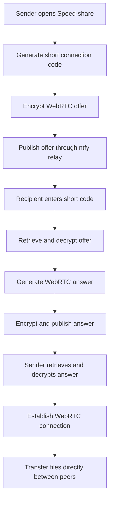
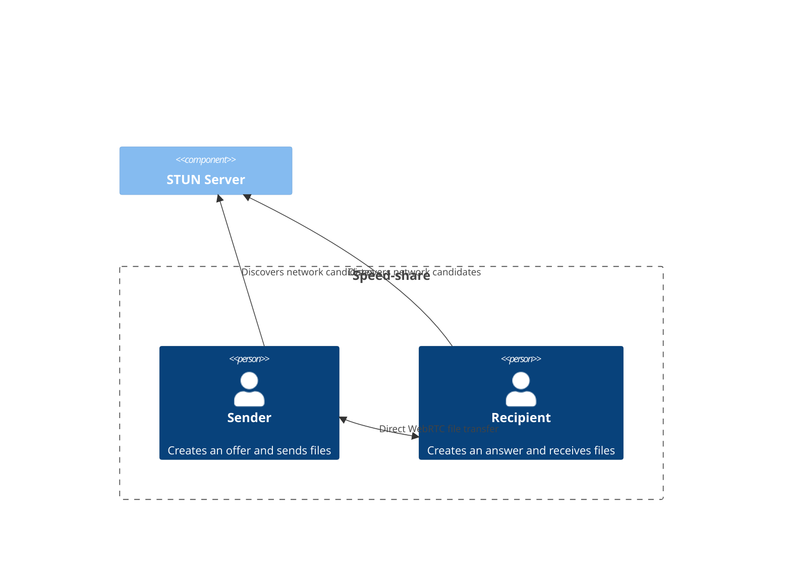
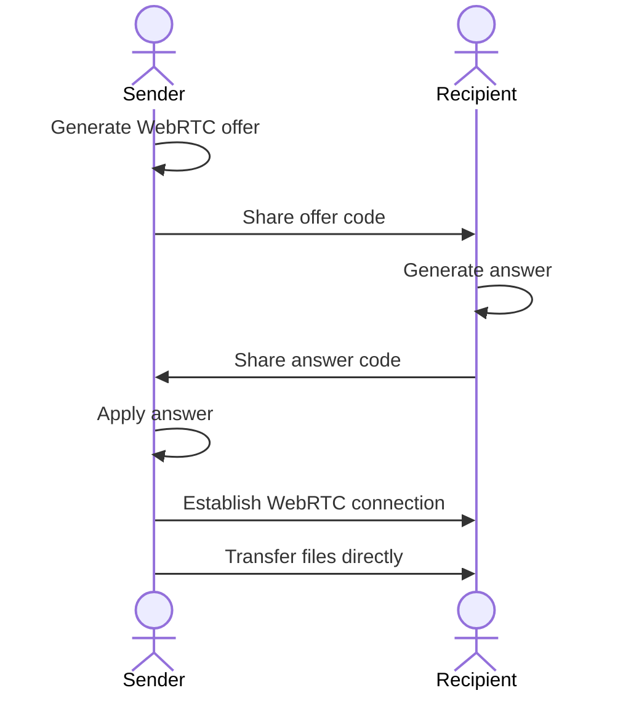
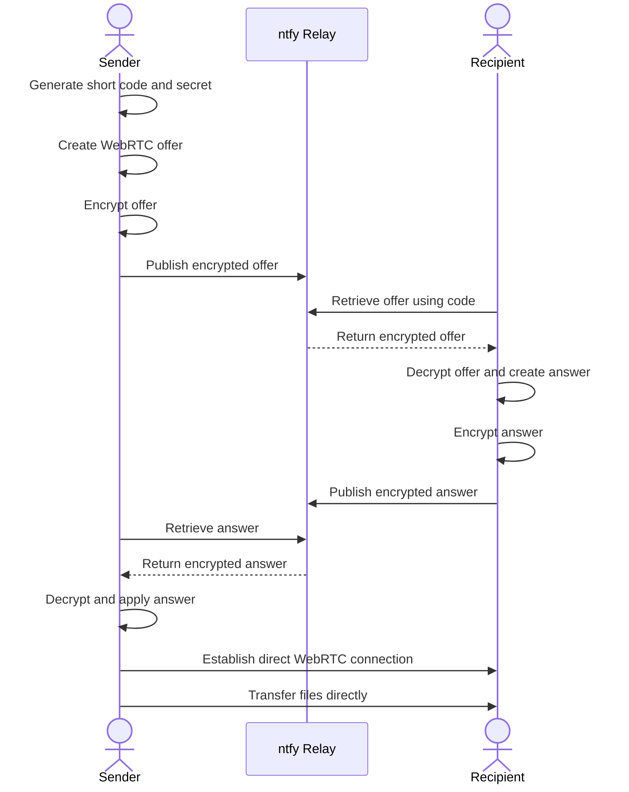

# Speed-share

<div align="center">


**Fast, Secure, Peer-to-Peer File Sharing**

[](LICENSE)
[
[](https://webassembly.org/)


</div>

## 🚀 Overview

Speed-share is a modern web application for fast, secure, peer-to-peer file sharing. It uses WebRTC to transfer files directly between devices, with end-to-end encryption options, WebAssembly compression, and a simple interface.

With the new short-code signaling system, connecting two devices is easier than ever. Instead of manually copying long WebRTC offer and answer codes, users can share a compact connection code and let the application handle signaling automatically.

Files are transferred directly between peers rather than uploaded to a central file-storage server.

## ✨ Features

- 🔐 **End-to-End Encryption** — Encryption options for protecting file transfers.
- 🔗 **Short-Code Connections** — Generate compact codes such as `K7QXM-29PD9` instead of exchanging long signaling payloads manually.
- 📡 **Automatic Signaling** — Exchange WebRTC offers and answers through a public ntfy relay without requiring a second code to be copied.
- 🔒 **Encrypted Signaling** — Connection offers and answers are encrypted using a secret derived from the connection code before being sent through the relay.
- ⏱️ **Temporary Connection Codes** — Codes are designed to expire after 15 minutes and be single-use.
- ⚡ **Faster Connection Setup** — Reduce unnecessary waiting during ICE candidate discovery.
- 📷 **QR Code Sharing** — Share connection details using scannable QR codes where supported by the interface.
- 🔄 **Manual Signaling Fallback** — Continue using existing long offer and answer codes when the short-code relay is unavailable or blocked.
- ⚙️ **Customizable STUN Servers** — Configure network traversal settings to improve connectivity.
- 📦 **Adjustable Chunk Size** — Tune file chunk sizes for different network conditions.
- 🎛️ **Recipient Controls** — Recipients can configure the maximum accepted file size.
- 🧩 **WebAssembly Compression** — Use WebAssembly for efficient file compression.
- 🗂️ **No Central File Storage** — Files are transferred directly between peers without being stored on the signaling relay.
- 🌐 **Cross-Platform Compatibility** — Works with modern browsers on supported desktop and mobile devices.

## 📸 Screenshots

<div align="center">


</div>

## 🎮 How to Use

<div align="center">

[](https://github.com/user-attachments/assets/2f19252b-b55b-47db-8769-dd74f544c7fb)

</div>

### 🔗 Connecting with a Short Code

Speed-share's short-code signaling system uses a public relay to exchange connection information. This eliminates the need to manually copy and paste long WebRTC offer and answer payloads.

#### 🙌 For Senders

1. Visit [Speed-share](https://speed-shares.vercel.app/).
2. Generate a short connection code.
3. Share the code with your recipient using the available copy, link, or QR-code options.
4. Wait for the recipient to enter the code and respond through the signaling relay.
5. Allow the application to establish the WebRTC connection.
6. Select your files and begin transferring.

Example connection code:

```text
K7QXM-29PD9
```

#### 🤝 For Recipients

1. Visit [Speed-share](https://speed-shares.vercel.app/).
2. Enter the sender's short code, open the shared connection link, or scan the QR code when supported.
3. Allow the application to retrieve the encrypted signaling information through the relay.
4. The application sends the answer back automatically.
5. Wait for the WebRTC connection to be established.
6. Accept incoming files.

**No second answer code needs to be manually copied in the short-code flow.**

### 🔁 Using Manual Signaling

The existing manual signaling flow remains available for compatibility and fallback.

#### For Senders

1. Open [Speed-share](https://speed-shares.vercel.app/).
2. Generate a WebRTC offer.
3. Copy the generated offer code or share its QR code.
4. Send it to the recipient.
5. Receive the recipient's answer code.
6. Paste the answer code into the application to establish the connection.
7. Select and send files.

#### For Recipients

1. Open [Speed-share](https://speed-shares.vercel.app/).
2. Enter the sender's offer code or scan the QR code.
3. Generate a WebRTC answer.
4. Copy the answer code and send it to the sender.
5. Wait for the sender to enter the answer and establish the connection.
6. Accept incoming files.

## 🧭 How It Works

Speed-share uses WebRTC for peer-to-peer connectivity. A signaling mechanism is required to exchange the connection details before the two devices can communicate directly.

### Short-Code Signaling Architecture



### Manual Signaling Architecture



### Manual Signaling Sequence



### Short-Code Signaling Sequence



The relay facilitates signaling only. It does not need to carry the actual file data.

## 🔐 Security and Privacy

### Encrypted Signaling

A WebRTC offer contains connection information, including network candidates and DTLS fingerprint information. Audio/video configurations may also add substantial codec information, which makes the complete signaling payload too large for a short human-readable code.

A short code therefore acts as a lookup key rather than containing the entire WebRTC offer.

The short-code implementation derives a secret key from the connection code and encrypts the offer and answer before publishing them through the relay.

### Temporary Codes

- **Expiration:** Codes are intended to expire after 15 minutes.
- **Single use:** Codes are intended to be consumed once.
- **Secret-based access:** The code is used to derive the key needed to decrypt signaling data.
- **Encrypted relay payloads:** The relay receives encrypted signaling data rather than the plaintext offer and answer.

The short code has approximately 50 bits of entropy according to the implementation description. This is a temporary connection secret, not a replacement for a strong permanent account credential.

Treat connection codes like passwords. Share them only with the intended recipient.

### Peer-to-Peer File Transfers

Once the WebRTC connection is established, files are transferred directly between the sender and recipient. The signaling relay is not used as file storage.

WebRTC uses DTLS to protect its transport. Speed-share also provides application-level encryption options for file transfers.

The strength of the overall security depends on the implementation, the cryptographic settings, and whether the relevant security paths have been tested.

### Public Relay Considerations

The default short-code signaling relay is [ntfy.sh](https://ntfy.sh/).

Using a public relay means that connection setup depends on an external service. Although signaling payloads are encrypted, the relay may still observe metadata such as request timing, message sizes, and traffic patterns.

Anonymous use may be subject to rate limits or other service restrictions. Relay availability is not guaranteed.

For additional control and reliability, you can configure a self-hosted ntfy server in the application's relay configuration.

### Security Review Status

The short-code signaling implementation still requires testing. In particular:

- Verify that offer and answer payloads are encrypted and decrypted correctly.
- Verify that the secret derived from the code protects access to the signaling exchange.
- Test expiration and single-use behavior.
- Test resistance to accidental code reuse and concurrent connection attempts.
- Test relay failures and fallback to manual signaling.
- Review the existing `crypto.ts` implementation for AES-GCM IV reuse and the use of 1024-bit RSA keys before relying on those paths in production.

## ⚡ Connection Speed

The short-code implementation reduces unnecessary waiting during ICE candidate discovery.

Instead of waiting for all possible network candidates before making a code available, the implementation can proceed after discovering the first public address, with a bounded wait.

The implementation targets approximately **1.2 seconds after the first public address is discovered**, or a maximum wait of approximately **4 seconds**, depending on the network and discovery behavior.

These figures describe the intended signaling-code generation behavior, not a guarantee that a complete peer-to-peer connection will be established in that time.

Actual connection speed depends on network conditions, STUN responses, firewall restrictions, relay availability, and the browsers being used.

## ⚙️ Advanced Options

- 🔐 **Encryption Settings:** Configure the available file-transfer encryption options.
- 📦 **Chunk Size Adjustment:** Modify chunk sizes to suit your network conditions.
- 📡 **STUN Server Configuration:** Configure STUN servers for network candidate discovery.
- 📏 **Maximum File Size:** Allow recipients to set the maximum file size they are willing to accept.
- 🔗 **Signaling Relay:** Use the configured public relay or add a self-hosted ntfy endpoint to the relay configuration.
- 🔄 **Manual Signaling:** Use long offer and answer codes when short-code signaling is unavailable.

## 🛠️ Technical Details

Speed-share uses modern web technologies to enable peer-to-peer file sharing.

| Technology | Purpose |
|---|---|
| WebRTC | Establishes peer-to-peer connections and transfers file data |
| ICE | Discovers and negotiates possible network paths |
| STUN | Helps discover network addresses for connectivity |
| DTLS | Protects the WebRTC transport |
| ntfy | Relays short-code signaling messages |
| Web Crypto API | Provides cryptographic primitives for supported encryption flows |
| WebAssembly | Supports efficient file compression |
| Progressive Web App | Provides supported application and offline capabilities |
| Svelte | Builds the application's user interface |

### Relevant Source Files

| File | Responsibility |
|---|---|
| `OfferPage.svelte` | Sender interface and offer creation |
| `ReceivePage.svelte` | Recipient interface and answer handling |
| `shortCode.ts` | Short-code signaling and relay communication |
| `manualSignaling.ts` | Existing manual offer and answer signaling |
| `crypto.ts` | Cryptographic helpers used by the application |

The short-code module is intended to live alongside `manualSignaling.ts` in the `utils` directory.

## 🧪 Testing Status

The short-code signaling changes require end-to-end testing before being considered production-ready.

Recommended checks:

- [ ] Connect two browsers on different networks.
- [ ] Verify short-code generation and sharing.
- [ ] Verify offer retrieval and automatic answer delivery.
- [ ] Verify that signaling payloads are encrypted.
- [ ] Verify the 15-minute expiration.
- [ ] Verify single-use behavior.
- [ ] Test QR-code and shared-link flows.
- [ ] Test when the public relay is blocked or unavailable.
- [ ] Verify fallback to long offer and answer codes.
- [ ] Complete a file transfer after connecting.
- [ ] Check the current ntfy.sh usage limits.
- [ ] Test with a self-hosted ntfy relay.
- [ ] Review the existing cryptographic implementation for security issues.

**Testing note:** The short-code changes have not yet been verified across browsers and different networks. The expected timing and relay behavior should be treated as implementation targets until these tests pass.

## 🔗 Links

- 🌐 **Live Application:** [Speed-share](https://speed-shares.vercel.app/)
- 🐛 **Report Issues:** [GitHub Issues](https://github.com/username/speed-share/issues)
- 💻 **Source Code:** [GitHub Repository](https://github.com/username/speed-share)
- 📚 **Documentation:** [Project Wiki](https://github.com/username/speed-share/wiki)
- 📥 **Installation Guide:** [Installation](https://github.com/username/speed-share/wiki/installation)
- ❓ **FAQ:** [Frequently Asked Questions](https://github.com/username/speed-share/wiki/faq)
- 📡 **ntfy Documentation:** [docs.ntfy.sh](https://docs.ntfy.sh/)

> **Note:** Replace the `username/speed-share` repository placeholders with the actual GitHub repository URL if they are still placeholders in your project.

## 📜 License

This project is licensed under the MIT License. See the [LICENSE](LICENSE) file for details.

---

<div align="center">


[Documentation](https://github.com/username/speed-share/wiki) |
[Installation Guide](https://github.com/username/speed-share/wiki/installation) |
[FAQ](https://github.com/username/speed-share/wiki/faq)

Made with ❤️ by Speed-share Team

</div>